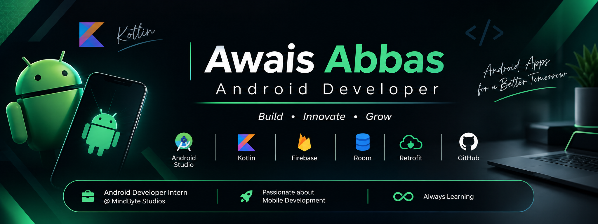

<div align="center">
  
</div>
# 👨‍💻 Awais Abbas | Android Developer

<!-- ==================== HEADER ==================== -->

<div align="center">

  

  <br/>

  <a href="https://portfolio-awais-abbas.vercel.app/">
    
  </a>
  <a href="https://www.linkedin.com/in/awaisabbas7/">
    
  </a>
  <a href="https://github.com/malikawaisabbas7">
    
  </a>

</div>

---

## About Me

I'm **Awais Abbas**, an Android Developer focused on building practical, user-friendly, and maintainable Android applications using Kotlin.

Currently working as an **Android Developer Intern at MindByte Studios**, where I am strengthening my understanding of professional Android development workflows, application architecture, and real-world software engineering practices.

I enjoy turning ideas into functional mobile applications, understanding how applications work internally, and continuously improving the quality of my code.

```kotlin
val developer = mapOf(
    "name" to "Awais Abbas",
    "role" to "Android Developer",
    "primaryLanguage" to "Kotlin",
    "platform" to "Android",
    "currentlyWorkingAt" to "MindByte Studios",
    "focus" to "Building maintainable Android applications",
    "learning" to "Clean Architecture, Hilt & advanced Android development"
)
```

### What I Focus On

- 📱 Developing Android applications with Kotlin and XML.
- 🏗️ Understanding MVVM, Repository Pattern, and application architecture.
- 🌐 Integrating REST APIs using Retrofit and Kotlin Coroutines.
- 💾 Managing local application data with Room Database.
- 🔥 Working with Firebase services and authentication.
- 🎨 Creating intuitive Android interfaces using Material Design.
- 🧪 Improving application reliability through debugging and testing.

---

## 🛠️ Technology Stack

### Android Development

<div align="left">


</div>

### Architecture & Libraries

<div align="left">


</div>

| Category | Technologies |
|---|---|
| Languages | Kotlin, Java |
| Android UI | XML, Material Design, RecyclerView |
| Architecture | MVVM, MVC, MVP, Repository Pattern |
| Networking | Retrofit, REST APIs, Kotlin Coroutines |
| Local Storage | Room Database |
| Backend Services | Firebase Authentication, Firebase Cloud Messaging |
| Android Components | Activities, Fragments, Intents, ViewModel, LiveData |
| Development Tools | Android Studio, Git, GitHub, Postman |
| Currently Exploring | Hilt, Clean Architecture, Dependency Injection |

---

## 🚀 Featured Projects

### 🛒 Grocery List & Budget Management App

A personal finance and grocery management Android application designed to help users organize shopping items, manage budgets, and track expenses.

**Key Features**
- Grocery list and item management.
- Budget allocation and expense tracking.
- Remaining budget calculations.
- Category-based organization.
- Search and sorting functionality.
- Spending alerts and financial reports.

**Tech Stack:** Kotlin · XML · MVVM · Room Database · Firebase Authentication

[View Project Repository](https://github.com/malikawaisabbas7/GroceryBudgetApp)

---

### 🌦️ Weather & News Application

An Android application that combines real-time weather information with news articles to provide users with useful information in one place.

**Key Features**
- Current weather information.
- Temperature, humidity, and wind details.
- Weather forecast information.
- News articles retrieved from REST APIs.
- Location-based weather information.
- MVVM and Repository Pattern implementation.

**Tech Stack:** Kotlin · XML · MVVM · Retrofit · REST APIs · Coroutines

---

### 📡 Bluetooth Device Tracker

An Android application focused on discovering nearby Bluetooth devices and displaying relevant device information.

**Key Features**
- Nearby Bluetooth device discovery.
- Device name and address information.
- RSSI-based signal strength.
- Bonding state information.
- Device discovery and permission handling.

**Tech Stack:** Kotlin · XML · Android Bluetooth APIs · MVVM

---

## 📊 GitHub Analytics

<div align="center">

  

  

</div>

<div align="center">

  

</div>

---

## 🎯 Current Goals

- Strengthening Kotlin and Android development fundamentals.
- Writing clean, readable, and maintainable code.
- Improving understanding of MVVM and Clean Architecture.
- Learning Dependency Injection with Hilt.
- Building production-oriented Android applications.
- Becoming a professional Android Software Engineer.

---

## 🤝 Let's Connect

I'm always interested in connecting with Android developers, software engineers, and people who enjoy building meaningful technology.

<div align="center">

  <a href="https://portfolio-awais-abbas.vercel.app/">
    
  </a>

  <a href="https://www.linkedin.com/in/awaisabbas7/">
    
  </a>

  <a href="https://github.com/malikawaisabbas7">
    
  </a>

  <br/><br/>

  **Building. Learning. Improving. One commit at a time.**

</div>
